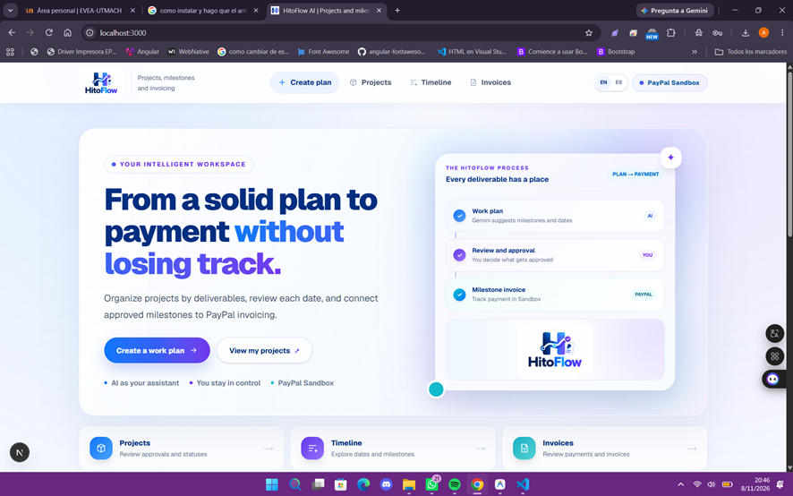
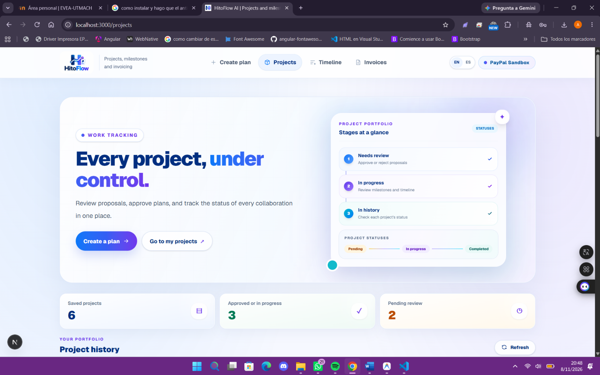
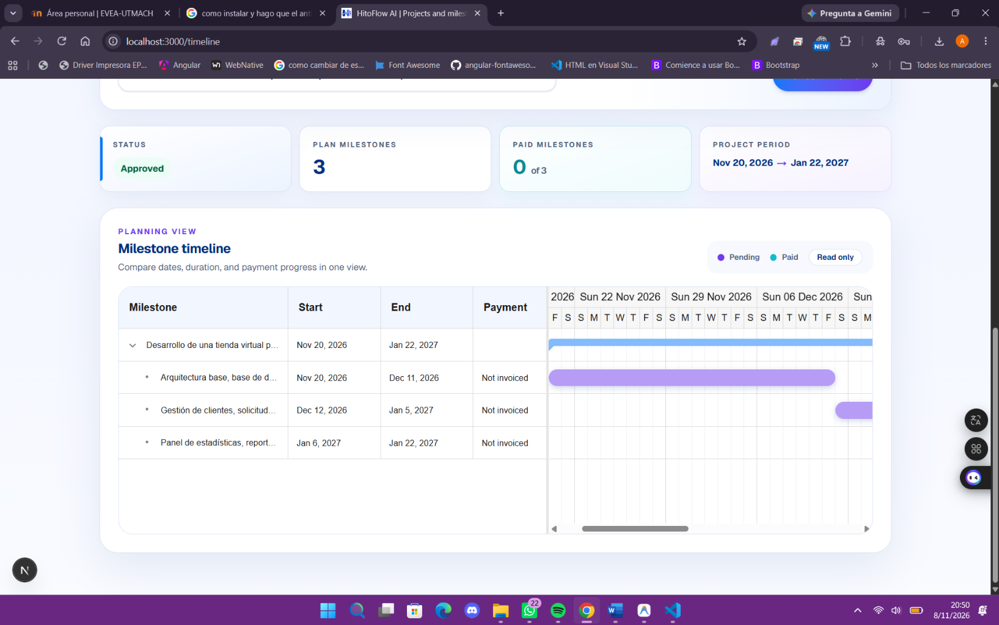
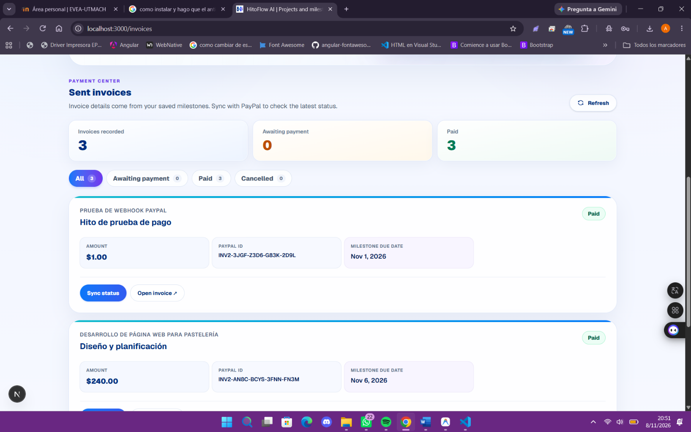
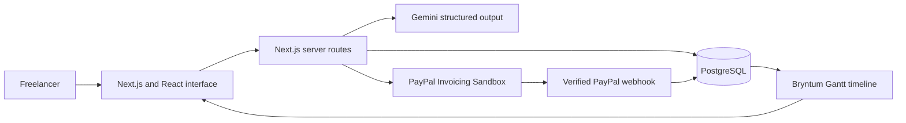
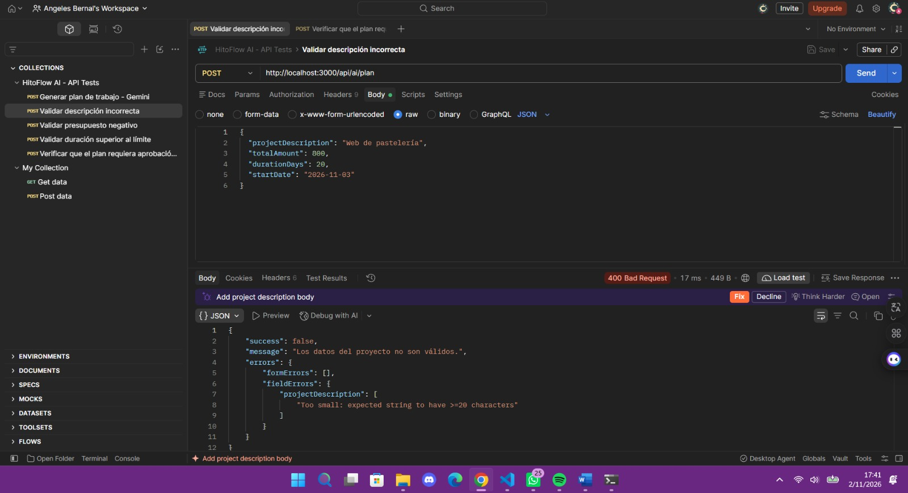
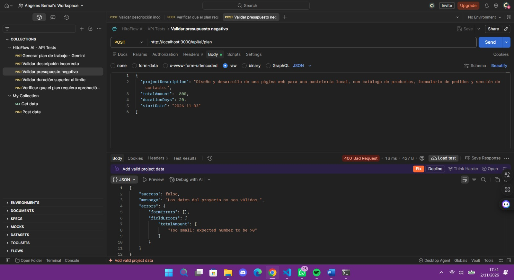
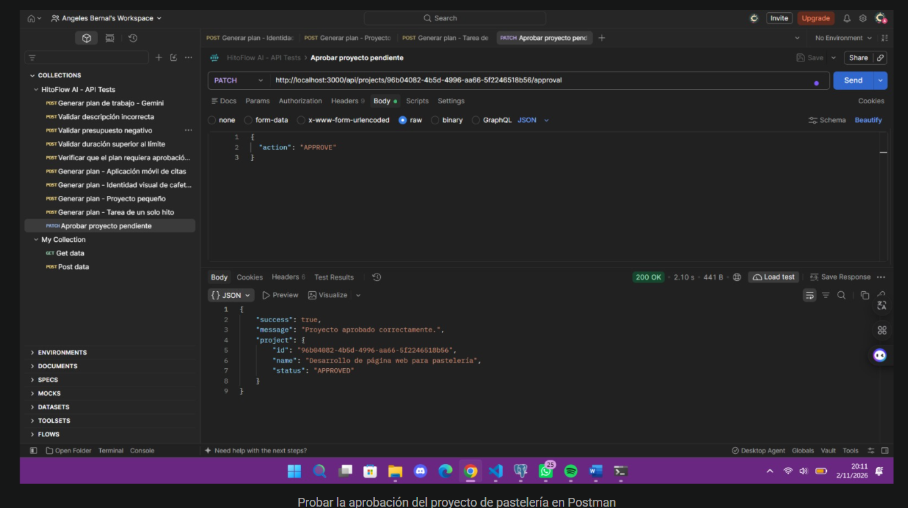
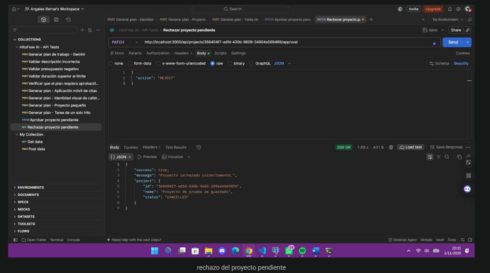

# HitoFlow AI

**A payment-aware project planner for freelancers and small agencies, built with Gemini, PayPal Sandbox, PostgreSQL, and Bryntum Gantt.**

[Open the live application](https://hitoflow-ai.onrender.com/) · [View the license](LICENSE)

> The application is hosted on Render's free tier. The first request after a period of inactivity may take a short time while the service wakes up.

HitoFlow AI turns an informal client brief into a structured, reviewable work plan. Gemini proposes one to three milestones with dates, percentages, and amounts; the freelancer remains in control by approving or rejecting the plan before any invoice can be created. Approved milestones can be billed through PayPal Invoicing in the Sandbox environment, and payment status is reflected in the project timeline.

Built for the **PayPal AI Hackathon 2026**.



## The problem

Freelancers often manage project scope, delivery dates, and payments in separate conversations and tools. When a payment is delayed, it becomes difficult to decide whether work should continue and whether the original schedule is still realistic.

HitoFlow AI connects those decisions in one workflow:

1. Describe the client project, budget, duration, and start date.
2. Gemini creates a structured proposal with up to three verifiable milestones.
3. Review the dates and amounts, then approve or reject the proposal.
4. Create a PayPal Sandbox invoice from an approved milestone.
5. Synchronize the invoice or receive a verified webhook when it is paid.
6. Review payment-aware milestones in a Bryntum Gantt timeline.
7. For overdue unpaid work, request an AI rescheduling proposal and apply it only after human confirmation.

## Live demo

The public deployment is available at:

**https://hitoflow-ai.onrender.com/**

No login is required. The interface supports **English and Spanish** through the language selector in the header.

The deployment uses a shared demonstration database. Do not enter real client information, production credentials, or personal financial data. All PayPal operations use the Sandbox environment and do not move real money.

## Core capabilities

- **Structured AI planning:** Gemini returns JSON that is validated before it is saved.
- **Server-side safeguards:** descriptions, budgets, durations, milestone totals, percentages, and dates are checked with Zod and deterministic rules.
- **Human approval:** generated projects start as `PENDING_APPROVAL` and must be approved before billing.
- **Project history:** filter and review pending, approved, and rejected projects.
- **PayPal Sandbox invoicing:** create and send an invoice using the amount and description stored in an approved milestone.
- **Payment synchronization:** query PayPal for the latest invoice state and update the associated milestone.
- **Verified webhooks:** validate PayPal webhook signatures and ignore duplicate event IDs.
- **Visual planning:** display project and milestone dates in a read-only Bryntum Gantt timeline.
- **AI-assisted rescheduling:** propose new dates for overdue unpaid milestones while preserving order and duration.
- **Bilingual experience:** switch the interface and AI-generated content between English and Spanish.

## Product views

### Human review and project history



### Payment-aware milestone timeline



### PayPal Sandbox invoice history



## Architecture



| Layer      | Technology                                     | Responsibility                                                            |
| ---------- | ---------------------------------------------- | ------------------------------------------------------------------------- |
| Interface  | Next.js 16, React 19, TypeScript, Tailwind CSS | Project creation, approval, invoice history, and bilingual UI             |
| AI         | Gemini API                                     | Structured milestone plans and rescheduling proposals                     |
| Validation | Zod and deterministic server rules             | Validate requests, AI output, totals, percentages, dates, and identifiers |
| Database   | PostgreSQL                                     | Projects, milestones, PayPal invoice references, and webhook events       |
| Payments   | PayPal Invoicing API in Sandbox                | OAuth, invoice creation, sending, lookup, and payment state               |
| Events     | PayPal Webhooks                                | Signature verification and idempotent payment processing                  |
| Timeline   | Bryntum Gantt Community                        | Read-only milestone schedule and payment visualization                    |
| Hosting    | Render                                         | Web service, environment variables, and managed PostgreSQL                |

## PayPal integration

PayPal is part of the core project workflow rather than a standalone checkout screen.

1. The server loads an approved milestone from PostgreSQL.
2. It obtains a PayPal Sandbox OAuth token using server-side credentials.
3. It creates and sends an invoice with the stored milestone name and amount.
4. The PayPal invoice ID and payer-view URL are stored against that milestone.
5. The application can synchronize the invoice status directly with PayPal.
6. An `INVOICING.INVOICE.PAID` webhook marks the linked milestone as paid after signature verification.
7. Duplicate webhook events are detected by their unique PayPal event ID.

Only the recipient's Sandbox email is accepted from the browser. Invoice amount and description are loaded from the approved database record.

## AI integration and human control

Gemini is used for two bounded tasks:

- Generate one to three milestones from a project brief.
- Suggest new dates for overdue unpaid milestones.

The application does not trust AI output directly. The backend requires structured JSON and verifies:

- One to three milestones.
- Percentages that total 100%.
- Amounts that match the project budget.
- Dates inside the allowed project period.
- Chronological milestone order.
- Rescheduling that preserves milestone duration and does not overlap other milestones.
- Paid milestones remain unchanged.

AI-generated plans and rescheduling proposals require explicit human approval before they change the workflow.

## Technology stack

- Next.js `16.4.3`
- React `19.3.0`
- TypeScript
- Tailwind CSS 4
- Google Gen AI SDK and Gemini
- PayPal Invoicing and Webhooks REST APIs
- PostgreSQL and `pg`
- Zod
- Bryntum Gantt Community `8.0.0`
- Render Blueprint deployment

## Local setup

### Requirements

- Node.js 20 or newer
- npm
- PostgreSQL
- A Gemini API key
- A PayPal Developer application with Sandbox credentials
- A PayPal Sandbox webhook configured for invoice events

### 1. Install dependencies

```bash
npm ci
```

### 2. Configure environment variables

Copy `.env.example` to `.env.local` and provide your own development credentials.

```bash
cp .env.example .env.local
```

On Windows PowerShell:

```powershell
Copy-Item .env.example .env.local
```

| Variable               | Required         | Purpose                                              |
| ---------------------- | ---------------- | ---------------------------------------------------- |
| `GEMINI_API_KEY`       | Yes              | Server-side access to Gemini                         |
| `PAYPAL_CLIENT_ID`     | Yes              | PayPal Sandbox application ID                        |
| `PAYPAL_CLIENT_SECRET` | Yes              | PayPal Sandbox server credential                     |
| `PAYPAL_BASE_URL`      | Yes              | Use `https://api-m.sandbox.paypal.com`               |
| `PAYPAL_WEBHOOK_ID`    | Yes for webhooks | Verifies webhook signatures                          |
| `DATABASE_URL`         | Recommended      | PostgreSQL connection string for hosted environments |
| `DB_HOST`              | Alternative      | PostgreSQL host when `DATABASE_URL` is not used      |
| `DB_PORT`              | Alternative      | PostgreSQL port; defaults to `5432`                  |
| `DB_NAME`              | Alternative      | PostgreSQL database name                             |
| `DB_USER`              | Alternative      | PostgreSQL user                                      |
| `DB_PASSWORD`          | Alternative      | PostgreSQL password                                  |

Never commit `.env.local`, API keys, access tokens, database credentials, or real PayPal credentials.

### 3. Create the database schema

```bash
npm run db:migrate
```

The migration is idempotent and creates the `projects`, `milestones`, and `webhook_events` tables when they do not exist.

### 4. Add optional demonstration data

Use a dedicated development or demo database because the seed script replaces projects named `Tienda Aurora` and `Identidad Café Norte`.

```bash
npm run db:seed
```

The seed provides:

- An approved project ready for the invoice flow.
- A project with an overdue unpaid milestone ready for the rescheduling flow.

### 5. Start the application

```bash
npm run dev
```

Open [http://localhost:3000](http://localhost:3000).

## Judge walkthrough

The complete product flow can be tested without a login:

1. Open the [live application](https://hitoflow-ai.onrender.com/).
2. Keep **EN** selected or switch to **ES** from the header.
3. Enter a project name, a detailed description of at least 20 characters, a positive budget, a duration from 1 to 365 days, and a start date.
4. Select **Generate proposal with Gemini** and review every milestone, amount, and date.
5. Open **Projects** and approve or reject the pending proposal.
6. For an approved project, open **Invoices**, select a milestone without an invoice, and use a PayPal Sandbox personal-account email.
7. Open or pay the invoice in PayPal Sandbox, then use **Sync status** or allow the verified webhook to update the milestone.
8. Open **Timeline** to see milestone dates and payment states in Bryntum Gantt.
9. If a project contains an overdue unpaid milestone, generate a rescheduling suggestion and review it before applying the new dates.

The free Render service may need to wake up before the first page load. If the shared demonstration database is empty, create a project through the first step above.

## API routes

| Method  | Route                                     | Purpose                                              |
| ------- | ----------------------------------------- | ---------------------------------------------------- |
| `POST`  | `/api/ai/plan`                            | Generate, validate, and save a plan pending approval |
| `GET`   | `/api/projects`                           | List projects and their milestones                   |
| `PATCH` | `/api/projects/:id/approval`              | Approve or reject a pending plan                     |
| `POST`  | `/api/projects/:id/reschedule-suggestion` | Generate a proposal for overdue unpaid milestones    |
| `PATCH` | `/api/projects/:id/reschedule`            | Apply a confirmed rescheduling proposal              |
| `POST`  | `/api/paypal/token`                       | Verify PayPal Sandbox authentication                 |
| `POST`  | `/api/paypal/invoices`                    | Create and send an invoice for an approved milestone |
| `GET`   | `/api/paypal/invoices/:id`                | Read and synchronize an invoice with PayPal          |
| `POST`  | `/api/paypal/webhooks`                    | Verify and process PayPal webhook events             |
| `GET`   | `/api/db-check`                           | Check database connectivity                          |

## Validation and test evidence

Manual API validation was performed with Postman for successful and unsuccessful cases, including:

- Valid project-plan generation with different scopes, budgets, and durations.
- Rejection of descriptions shorter than 20 characters.
- Rejection of negative budgets.
- Rejection of durations greater than 365 days.
- Confirmation that generated plans remain pending until human approval.
- Successful approval and rejection transitions.
- Successful PayPal Sandbox invoice creation, lookup, payment synchronization, and webhook processing.

<details>
<summary>View selected API evidence</summary>

### Input validation





### Human approval workflow





</details>

For local quality checks, run:

```bash
npm run lint
npm run build
```

## Render deployment

The repository includes `render.yaml`, which defines:

- A Node web service.
- A PostgreSQL database.
- `npm ci && npm run build` as the build command.
- Database migration before the production server starts.
- Server-side environment variables managed by Render.

Create a Render Blueprint from the repository and enter the Gemini and PayPal Sandbox secrets in the Render dashboard. The free PostgreSQL plan is intended for a temporary hackathon demonstration and should not be treated as permanent production storage.

## Security and privacy

- PayPal and Gemini credentials remain on the server.
- All payment activity uses PayPal Sandbox.
- Webhook signatures are verified with PayPal before an event is processed.
- Duplicate webhook events are handled idempotently.
- Invoice values come from approved database milestones, not browser-supplied amounts.
- AI output is schema-validated and remains subject to human approval.
- The public demo has no authentication and uses shared data; use fictional project information only.

## Current limitations

- The prototype supports USD invoices only.
- The public demo uses a shared database and has no individual user accounts.
- The Gantt timeline is read-only; schedule changes are applied through the reviewed rescheduling workflow.
- Automated payment updates depend on a correctly configured public PayPal webhook; manual synchronization is available as a fallback.
- Webhook processing currently focuses on confirmed invoice payments.
- Render free services can sleep after inactivity, and free database storage is not intended for long-term use.

## Team

Built by **Ángeles Bernal and Makena Reyes** for the PayPal AI Hackathon 2026.

## License

This project is released under the [MIT License](LICENSE).
